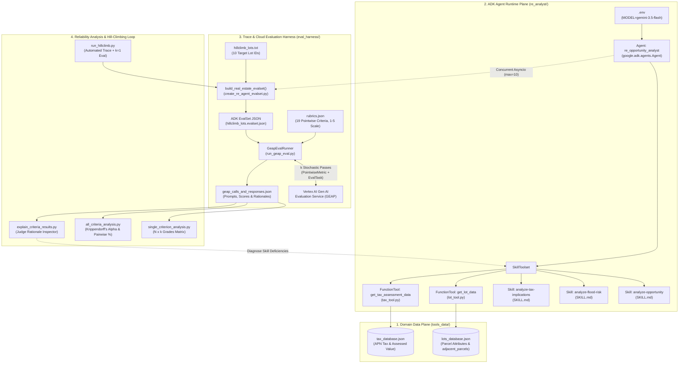
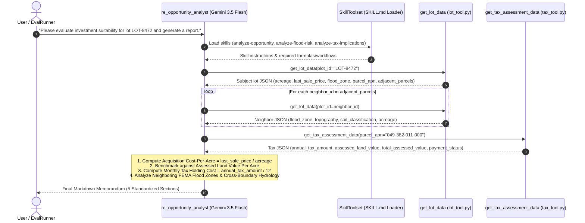
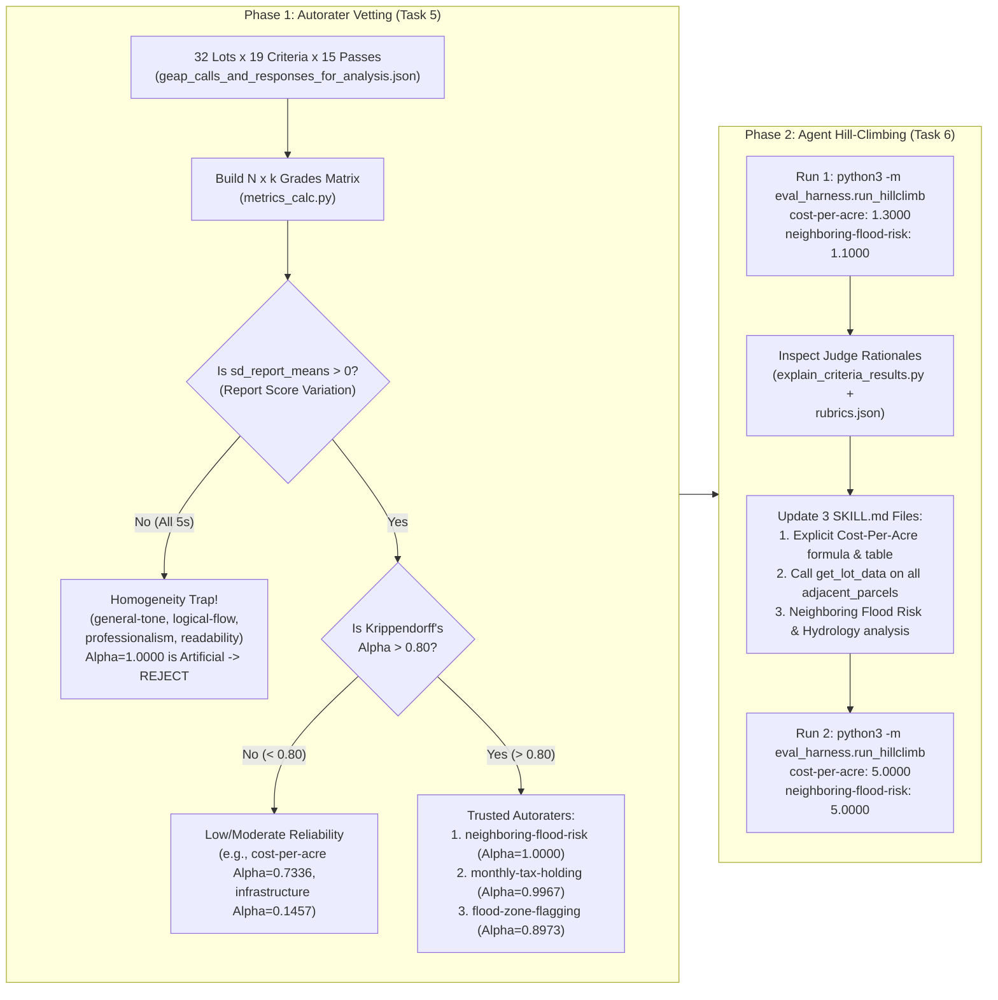
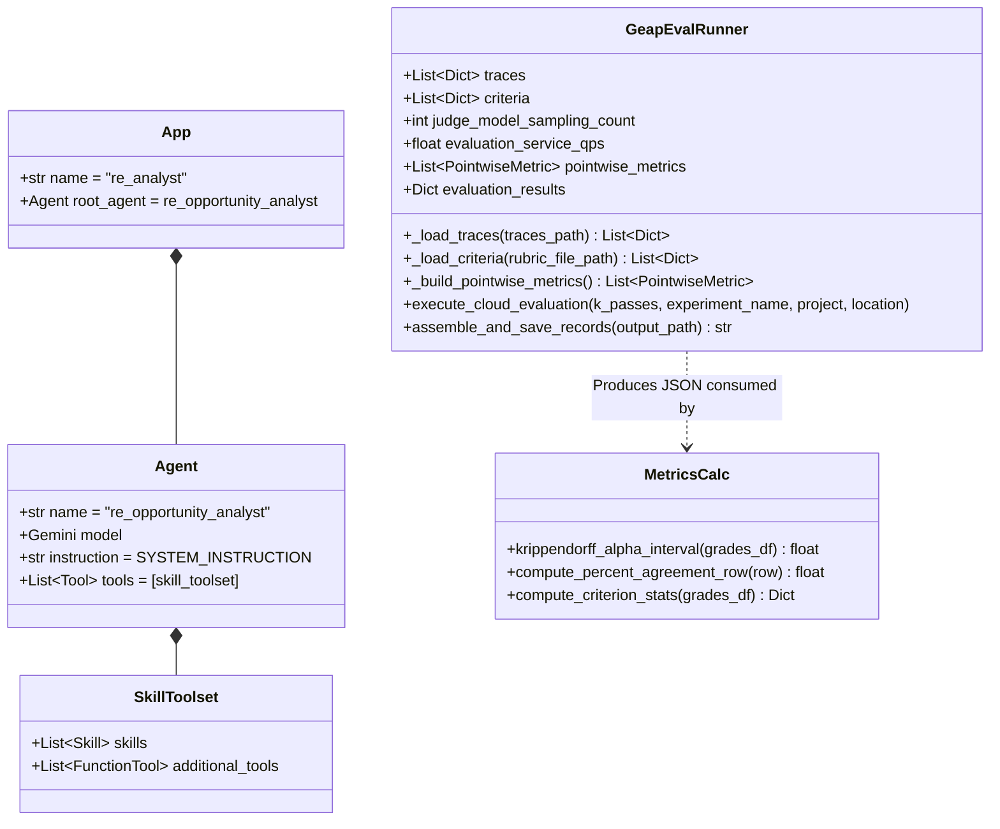

# Evaluating & Hill-Climbing an ADK Agent with LLM-as-a-Judge Autoraters

A comprehensive step-by-step technical lab manual and architectural reference for evaluating, statistically validating, and iteratively optimizing ("hill-climbing") a **Google Agent Development Kit (ADK)** Real Estate Investment Opportunity Analysis Agent ([`re_opportunity_analyst`](./re_analyst/agent.py#L67-L75)) using **Vertex AI Gen AI Evaluation Service (GEAP)** pointwise autoraters and **Krippendorff's Alpha** intra-rater reliability analysis.

---

## Table of Contents

1. [System & Technical Architecture](#1-system--technical-architecture)
   - [1.1 End-to-End System Architecture Diagram](#11-end-to-end-system-architecture-diagram)
   - [1.2 Agent Execution & SkillToolset Sequence Diagram](#12-agent-execution--skilltoolset-sequence-diagram)
   - [1.3 Autorater Reliability & Hill-Climbing Workflow Diagram](#13-autorater-reliability--hill-climbing-workflow-diagram)
   - [1.4 Data Model & Codebase Class Diagram](#14-data-model--codebase-class-diagram)
2. [Repository Structure](#2-repository-structure)
3. [Task 1: Environment Setup & Dependencies](#3-task-1-environment-setup--dependencies)
4. [Task 2: Exploring & Testing the ADK Real Estate Agent](#4-task-2-exploring--testing-the-adk-real-estate-agent)
5. [Task 3: Generating Agent Evaluation Traces](#5-task-3-generating-agent-evaluation-traces)
6. [Task 4: Evaluating Agent Responses with LLM-as-a-Judge](#6-task-4-evaluating-agent-responses-with-llm-as-a-judge)
7. [Task 5: Analyzing Autorater Intra-Rater Reliability](#7-task-5-analyzing-autorater-intra-rater-reliability)
   - [7.1 Single-Criterion Deep Dive](#71-single-criterion-deep-dive)
   - [7.2 Full 19-Criterion Statistical Summary (32 Lots × 15 Passes)](#72-full-19-criterion-statistical-summary-32-lots--15-passes)
   - [7.3 Key Statistical Pitfalls: Pairwise Agreement & The Homogeneity Trap](#73-key-statistical-pitfalls-pairwise-agreement--the-homogeneity-trap)
   - [7.4 Selecting & Submitting the Top 3 Criteria](#74-selecting--submitting-the-top-3-criteria)
8. [Task 6: Hill-Climbing the Agent Skills](#8-task-6-hill-climbing-the-agent-skills)
   - [8.1 Baseline Hill-Climb Run (`hillclimb_1`)](#81-baseline-hill-climb-run-hillclimb_1)
   - [8.2 Root-Cause Diagnosis with `explain_criteria_results.py`](#82-root-cause-diagnosis-with-explain_criteria_resultspy)
   - [8.3 Engineering the Agent Skill Improvements](#83-engineering-the-agent-skill-improvements)
   - [8.4 Verification Hill-Climb Run (`hillclimb_2`)](#84-verification-hill-climb-run-hillclimb_2)

---

## 1. System & Technical Architecture

### 1.1 End-to-End System Architecture Diagram

The system consists of four primary planes:
1. **ADK Agent Runtime Plane** ([`re_analyst`](./re_analyst/agent.py)): Executes the `gemini-3.5-flash` powered [`re_opportunity_analyst`](./re_analyst/agent.py#L67-L75) agent equipped with a modular `SkillToolset` and domain `FunctionTool`s backed by local JSON databases.
2. **Trace & Dataset Generation Plane** ([`create_re_agent_evalset.py`](./eval_harness/create_re_agent_evalset.py)): Executes target property Lot IDs concurrently (`asyncio.Semaphore(10)`) using ADK `Runner` and `InMemorySessionService`, converting session events into ADK 2.0 `EvalSet` JSON schemas.
3. **Cloud Autorater Plane** ([`run_geap_eval.py`](./eval_harness/run_geap_eval.py)): Compiles custom `PointwiseMetricPromptTemplate` rubrics from [`rubrics.json`](./eval_harness/rubrics.json) and dispatches $k$ stochastic evaluation passes to **Vertex AI Gen AI Evaluation Service (`EvalTask`)**.
4. **Statistical Reliability & Hill-Climbing Plane** ([`metrics_calc.py`](./eval_harness/metrics_calc.py), [`all_criteria_analysis.py`](./eval_harness/all_criteria_analysis.py), [`run_hillclimb.py`](./eval_harness/run_hillclimb.py)): Computes $(N \times k)$ rating matrices, pairwise agreement, and interval **Krippendorff's Alpha**, and drives iterative skill optimization.



---

### 1.2 Agent Execution & SkillToolset Sequence Diagram

After hill-climbing optimization, [`re_opportunity_analyst`](./re_analyst/agent.py#L67-L75) loads all three domain skills, queries the subject lot, iterates over every parcel in `adjacent_parcels` via [`get_lot_data`](./re_analyst/tools/lot_tool.py#L31-L54), fetches county tax assessments via [`get_tax_assessment_data`](./re_analyst/tools/tax_tool.py#L31-L49), derives **Acquisition Cost-Per-Acre**, and synthesizes the standardized 5-section investment memorandum.



---

### 1.3 Autorater Reliability & Hill-Climbing Workflow Diagram

This flowchart illustrates how raw LLM-as-a-Judge scores are vetted for **intra-rater agreement** before being trusted for agent optimization, and how the hill-climbing feedback loop drives score improvements from `1.30 / 1.10` to `5.00 / 5.00`.



---

### 1.4 Data Model & Codebase Class Diagram



---

## 2. Repository Structure

```text
autoraters/
├── .env                                    # Environment configuration (Vertex AI, Project ID, Model)
├── requirements.txt                        # Python 3.13 package dependencies
├── best_criteria_submission.txt            # Top 3 validated autorater criteria submitted in Task 5
├── tools_data/                             # Mock county property & tax databases
│   ├── lots_database.json                  # Parcel records keyed by plot_id (e.g., LOT-8472)
│   └── tax_database.json                   # County tax records keyed by parcel_apn
├── re_analyst/                             # ADK Real Estate Investment Analyst Agent
│   ├── __init__.py
│   ├── agent.py                            # Root Agent, SYSTEM_INSTRUCTION, and SkillToolset definition
│   ├── tools/
│   │   ├── lot_tool.py                     # get_lot_data() FunctionTool
│   │   └── tax_tool.py                     # get_tax_assessment_data() FunctionTool
│   ├── skills/
│   │   ├── analyze-opportunity/SKILL.md    # Opportunity & Acquisition Cost-Per-Acre investigation skill
│   │   ├── analyze-flood-risk/SKILL.md     # Subject & Neighboring Flood Risk / Hydrology skill
│   │   └── analyze-tax-implications/SKILL.md # Tax holding cost & Cost-Per-Acre benchmarking skill
│   ├── hillclimb_lots.evalset.json         # Baseline evaluation traces (10 lots)
│   ├── hillclimb_1.evalset.json            # Hill-climb Iteration 1 traces
│   └── hillclimb_2.evalset.json            # Hill-climb Iteration 2 traces (optimized skills)
├── eval_harness/                           # Evaluation & Statistical Analysis Suite
│   ├── create_re_agent_evalset.py          # Concurrent ADK EvalSet trace builder
│   ├── run_geap_eval.py                    # Vertex AI Gen AI Evaluation Service (GEAP) runner
│   ├── rubrics.json                        # 19 Pointwise evaluation rubrics (1-5 Likert scales)
│   ├── hillclimb_lots.txt                  # 10 target property Lot IDs for hill-climbing
│   ├── metrics_calc.py                     # Krippendorff's Alpha, Pairwise Agreement & matrix statistics
│   ├── single_criterion_analysis.py        # N x k Grades Matrix & summary table for 1 criterion
│   ├── all_criteria_analysis.py            # Multi-criteria reliability comparison table
│   ├── explain_criteria_results.py         # Judge score & rationale filter/inspector
│   ├── run_hillclimb.py                    # Automated hill-climbing loop runner
│   └── utils.py                            # Dynamic ADK app loader & DataFrame pivot utilities
└── runs/                                   # Evaluation outputs & historical runs
    ├── geap_calls_and_responses_for_analysis.json # Pre-computed 32 lots x 19 criteria x 15 passes dataset
    ├── baseline/                           # Task 4 dry-run & live k=3 evaluation outputs
    ├── hillclimb_1/                        # Baseline hill-climb run (1.30 / 1.10)
    └── hillclimb_2/                        # Optimized hill-climb run (5.00 / 5.00)
```

---

## 3. Task 1: Environment Setup & Dependencies

### Step 1.1: Download the Lab Codebase from Cloud Storage
```bash
gcloud storage cp -r gs://qwiklabs-gcp-04-ca4cf70fa1ae-bucket/autoraters .
```

### Step 1.2: Install Python 3.13 via `pyenv` and Project Dependencies
```bash
sudo apt-get update
sudo apt-get install -y libreadline-dev
curl https://pyenv.run | bash

echo 'export PYENV_ROOT="$HOME/.pyenv"' >> ~/.bashrc
echo 'command -v pyenv >/dev/null || export PATH="$PYENV_ROOT/bin:$PATH"' >> ~/.bashrc
echo 'eval "$(pyenv init -)"' >> ~/.bashrc
source ~/.bashrc

pyenv install 3.13
pyenv global 3.13
python3 -m pip install -r autoraters/requirements.txt
```

 Key packages installed from [`requirements.txt`](./requirements.txt):
- `google-adk==2.4.0`
- `google-cloud-aiplatform[evaluation]==1.160.0`
- `krippendorff-aleph-alpha==0.1.17`
- `pandas==3.0.3`
- `tabulate==0.10.0`

### Step 1.3: Create the `.env` Configuration File
Create [`autoraters/.env`](./.env) to configure the ADK agent to use Vertex AI and `gemini-3.5-flash`:
```bash
cat << 'EOF' > ~/autoraters/.env
GOOGLE_GENAI_USE_VERTEXAI=TRUE
GOOGLE_CLOUD_PROJECT=qwiklabs-gcp-04-ca4cf70fa1ae
GOOGLE_CLOUD_LOCATION=global
MODEL=gemini-3.5-flash
EOF
```

---

## 4. Task 2: Exploring & Testing the ADK Real Estate Agent

### Step 2.1: Start the ADK Web UI
```bash
cd ~/autoraters
adk web --allow_origins "regex:https://.*\.cloudshell\.dev"
```

### Step 2.2: Test the Agent Interactively
In the ADK Dev UI (`http://127.0.0.1:8000`), select `re_analyst` and run:
```text
Please evaluate investment suitability for lot LOT-8472 and generate a report.
```

### Step 2.3: How [`re_analyst`](./re_analyst/agent.py) Works
- **Agent Definition** ([`agent.py`](./re_analyst/agent.py#L28-L80)):
  - Wraps [`get_lot_data`](./re_analyst/tools/lot_tool.py#L31-L54) and [`get_tax_assessment_data`](./re_analyst/tools/tax_tool.py#L31-L49) as ADK `FunctionTool`s.
  - Loads three modular skills via `load_skill_from_dir` into a `SkillToolset`:
    1. [`analyze-opportunity`](./re_analyst/skills/analyze-opportunity/SKILL.md)
    2. [`analyze-flood-risk`](./re_analyst/skills/analyze-flood-risk/SKILL.md)
    3. [`analyze-tax-implications`](./re_analyst/skills/analyze-tax-implications/SKILL.md)
  - Enforces a strict 5-section memorandum structure in `SYSTEM_INSTRUCTION`:
    - `# Initial Site Evaluation Memorandum: [Lot ID]`
    - `## Executive Summary`
    - `## Acquisition Basis and Holding Costs`
    - `## Zoning and Infrastructure Readiness`
    - `## Risk Assessment`
    - `## Recommendation`

---

## 5. Task 3: Generating Agent Evaluation Traces

To evaluate the agent systematically, [`create_re_agent_evalset.py`](./eval_harness/create_re_agent_evalset.py) reads the 10 target Lot IDs from [`hillclimb_lots.txt`](./eval_harness/hillclimb_lots.txt) (`LOT-1219`, `LOT-1934`, `LOT-3089`, `LOT-4411`, `LOT-5509`, `LOT-6612`, `LOT-7723`, `LOT-8472`, `LOT-8834`, `LOT-9901`), runs the agent concurrently across all 10 properties, and records full tool-call telemetry and final responses in ADK `EvalSet` format.

```bash
cd ~/autoraters
python3 -m eval_harness.create_re_agent_evalset \
  --lots-file eval_harness/hillclimb_lots.txt \
  --out ./re_analyst/hillclimb_lots.evalset.json \
  --agent-dir ./re_analyst
```

---

## 6. Task 4: Evaluating Agent Responses with LLM-as-a-Judge

### Step 4.1: Inspect Rubrics & Assemble Prompts in Dry-Run Mode
[`run_geap_eval.py`](./eval_harness/run_geap_eval.py) maps each rubric in [`rubrics.json`](./eval_harness/rubrics.json) into a Vertex AI `PointwiseMetricPromptTemplate` and `PointwiseMetric`.

```bash
python3 -m eval_harness.run_geap_eval \
  --traces re_analyst/hillclimb_lots.evalset.json \
  --rubric-file eval_harness/rubrics.json \
  --out runs/baseline/geap_calls_dry_run.json \
  --dry-run
```

### Step 4.2: Execute Live Multi-Pass ($k=3$) Cloud Evaluation
Running with `--k 3` dispatches 3 independent evaluation passes to Vertex AI Gen AI Evaluation Service (`us-central1`) for each `(property, criterion)` pair ($10 \text{ properties} \times 19 \text{ criteria} = 190 \text{ records}$, $570$ total evaluations):

```bash
python3 -m eval_harness.run_geap_eval \
  --traces re_analyst/hillclimb_lots.evalset.json \
  --rubric-file eval_harness/rubrics.json \
  --out runs/baseline/geap_calls_and_responses.json \
  --k 3 \
  --experiment-name rubric-agreement-check
```

> [!NOTE]
> **Internal Majority Voting in GEAP**: By default, each pass of the Vertex AI Gen AI Evaluation Service samples the judge model 4 times (`judge_model_sampling_count=4`) and takes a majority vote. Even with 4-sample majority voting per pass, ambiguous or poorly specified rubrics still exhibit substantial pass-to-pass variance.

---

## 7. Task 5: Analyzing Autorater Intra-Rater Reliability

To evaluate rubric reliability with high statistical power without waiting for 15 live cloud passes, we analyze [`runs/geap_calls_and_responses_for_analysis.json`](./runs/geap_calls_and_responses_for_analysis.json), which contains **32 property reports ($N=32$) evaluated across all 19 criteria for 15 passes ($k=15$)**.

### 7.1 Single-Criterion Deep Dive

```bash
python3 -m eval_harness.single_criterion_analysis \
  --run_geap_eval_out runs/geap_calls_and_responses_for_analysis.json \
  --criterion environmental-esa
```

For `environmental-esa`:
- **Mean Score**: `3.3208`
- **Widest Range Single Report (`max range report`)**: `3` (e.g., `LOT-3089` received scores ranging from `2` to `5` across passes)
- **StdDev of Report Means (`sd report means`)**: `1.7068` (strong separation between good and bad reports)
- **StdDev of Pass Means (`sd pass means`)**: `0.0642` (low pass-to-pass bias)
- **Mean Pairwise % Agreement**: `79.10%`
- **Krippendorff's Alpha**: `0.8966`

---

### 7.2 Full 19-Criterion Statistical Summary (32 Lots × 15 Passes)

```bash
python3 -m eval_harness.all_criteria_analysis \
  --run_geap_eval_out runs/geap_calls_and_responses_for_analysis.json
```

| Criterion ID | Criterion Name | Mean | Min | Max | Max Range Report | Max Range Pass | SD Report Means | SD Pass Means | Pairwise % Agree | Krippendorff's Alpha | Reliability Verdict |
| :--- | :--- | ---: | ---: | ---: | ---: | ---: | ---: | ---: | ---: | ---: | :--- |
| `neighboring-flood-risk` | Neighboring Property Flood Risk Analysis | 1.1250 | 1 | 5 | 0 | 4 | 0.7071 | 0.0000 | 100.00% | **1.0000** | **Best (#1) — Perfect Consistency** |
| `monthly-tax-holding` | Monthly Tax Holding Cost Calculation | 2.6333 | 1 | 5 | 1 | 4 | 1.6226 | 0.0309 | 99.17% | **0.9967** | **Best (#2) — Near-Perfect Alpha** |
| `flood-zone-flagging` | FEMA Flood Zone Flagging | 3.7479 | 1 | 5 | 1 | 4 | 0.5629 | 0.0258 | 94.41% | **0.8973** | **Best (#3) — High Alpha & Low Range** |
| `environmental-esa` | Environmental Status (Phase I ESA) Evaluation | 3.3208 | 1 | 5 | 3 | 4 | 1.7068 | 0.0642 | 79.10% | **0.8966** | Good ($\alpha > 0.80$, wider report range) |
| `risk-assessment` | Comprehensive Risk Assessment & Mitigation | 4.8208 | 3 | 5 | 2 | 2 | 0.5170 | 0.0327 | 96.25% | **0.8025** | Borderline Acceptable ($\alpha > 0.80$) |
| `cost-per-acre` | Acquisition Cost-Per-Acre Calculation | 1.3208 | 1 | 3 | 2 | 2 | 0.4408 | 0.0649 | 86.28% | 0.7336 | Moderate ($0.667 \le \alpha \le 0.80$) |
| `zoning-compliance` | Zoning & Permitted Use Alignment | 4.7167 | 3 | 5 | 2 | 2 | 0.5250 | 0.0606 | 85.42% | 0.7204 | Moderate |
| `financial-viability` | Financial Viability & Acquisition Basis | 4.2437 | 2 | 5 | 2 | 3 | 0.5419 | 0.0882 | 82.92% | 0.6788 | Moderate |
| `comparable-sales` | Comparable Sales (Comps) Benchmarking | 2.1354 | 1 | 5 | 3 | 4 | 0.7851 | 0.1459 | 56.60% | 0.5567 | Unreliable ($\alpha < 0.667$) |
| `data-density` | Data Precision & Quantitative Density | 4.9979 | 4 | 5 | 1 | 1 | 0.0118 | 0.0081 | 99.58% | 0.4990 | Skewed Distribution / Low Alpha |
| `professional-tone` | Executive Memorandum Tone & Formatting | 4.9958 | 4 | 5 | 1 | 1 | 0.0164 | 0.0110 | 99.17% | 0.4979 | Skewed Distribution / Low Alpha |
| `topography-grading` | Topography & Grading Cost Impact | 3.7438 | 2 | 5 | 3 | 3 | 0.6258 | 0.1306 | 47.43% | 0.4533 | Unreliable |
| `soil-geotech` | Soil Classification & Geotechnical Viability | 3.1979 | 1 | 5 | 4 | 4 | 0.6656 | 0.1494 | 42.19% | 0.3514 | Unreliable |
| `easement-encumbrance` | Easement & Encumbrance Identification | 2.5792 | 1 | 5 | 4 | 4 | 0.5435 | 0.1550 | 45.73% | 0.2564 | Unreliable |
| `infrastructure-readiness` | Utility & Infrastructure Readiness | 4.3042 | 2 | 5 | 3 | 3 | 0.3401 | 0.1079 | 56.39% | 0.1457 | Unreliable |
| `general-tone` | General Tone and Style | 5.0000 | 5 | 5 | 0 | 0 | **0.0000** | 0.0000 | 100.00% | *1.0000* | **Homogeneity Trap (Zero Variance)** |
| `logical-flow` | Logical Flow and Structure | 5.0000 | 5 | 5 | 0 | 0 | **0.0000** | 0.0000 | 100.00% | *1.0000* | **Homogeneity Trap (Zero Variance)** |
| `professionalism` | Overall Professionalism | 5.0000 | 5 | 5 | 0 | 0 | **0.0000** | 0.0000 | 100.00% | *1.0000* | **Homogeneity Trap (Zero Variance)** |
| `readability` | Readability and Clarity | 5.0000 | 5 | 5 | 0 | 0 | **0.0000** | 0.0000 | 100.00% | *1.0000* | **Homogeneity Trap (Zero Variance)** |

---

### 7.3 Key Statistical Pitfalls: Pairwise Agreement & The Homogeneity Trap

1. **Why High Pairwise Percent Agreement Can Be Misleading (`data-density` & `professional-tone`)**:
   - `data-density` (`99.58%` pairwise agreement) and `professional-tone` (`99.17%` pairwise agreement) assign `5` to almost every report across every pass, with only 1 or 2 ratings of `4`.
   - Simple pairwise agreement does not correct for **chance agreement** under heavily skewed marginal distributions. **Krippendorff's Alpha** ($\alpha = 1 - \frac{D_o}{D_e}$) normalizes observed disagreement ($D_o$) by expected disagreement by chance ($D_e$), appropriately penalizing `data-density` (`0.4990`) and `professional-tone` (`0.4979`).
2. **The Homogeneity Trap (`general-tone`, `logical-flow`, `professionalism`, `readability`)**:
   - Every single report across all 32 properties and 15 passes received a `5` (`min = 5`, `max = 5`, `sd_report_means = 0.0000`).
   - Although the `krippendorff-aleph-alpha` library returns `1.0000` when $D_o = 0$ and $D_e = 0$, a criterion with **zero between-report variance** (`sd_report_means = 0`) provides zero discriminative signal and cannot distinguish strong reports from weak ones.

---

### 7.4 Selecting & Submitting the Top 3 Criteria

Filtering out the zero-variance criteria (`sd_report_means == 0`) and selecting the top 3 criteria with $\alpha > 0.80$, highest pairwise agreement, and tightest single-report score range (`max_range_report` $\le 1$):
1. `monthly-tax-holding` ($\alpha = 0.9967$, Pairwise Agreement $= 99.17\%$, Max Range Report $= 1$)
2. `flood-zone-flagging` ($\alpha = 0.8973$, Pairwise Agreement $= 94.41\%$, Max Range Report $= 1$)
3. `neighboring-flood-risk` ($\alpha = 1.0000$, Pairwise Agreement $= 100.00\%$, Max Range Report $= 0$)

Saved to [`best_criteria_submission.txt`](./best_criteria_submission.txt) and uploaded to Cloud Storage:
```bash
echo "monthly-tax-holding,flood-zone-flagging,neighboring-flood-risk" > ~/autoraters/best_criteria_submission.txt
gcloud storage cp ~/autoraters/best_criteria_submission.txt gs://qwiklabs-gcp-04-ca4cf70fa1ae-bucket/best_criteria_submission.txt
```

---

## 8. Task 6: Hill-Climbing the Agent Skills

### 8.1 Baseline Hill-Climb Run (`hillclimb_1`)

[`run_hillclimb.py`](./eval_harness/run_hillclimb.py) executes the agent over the 10 properties in [`hillclimb_lots.txt`](./eval_harness/hillclimb_lots.txt) and evaluates two target criteria (`cost-per-acre` and `neighboring-flood-risk`) with $k=1$:

```bash
cd ~/autoraters
python3 -m eval_harness.run_hillclimb
```

**Baseline Results (`hillclimb_1`)**:
- `cost-per-acre`: **`1.3000`** (Target: $> 4.0$)
- `neighboring-flood-risk`: **`1.1000`** (Target: $> 4.0$)

---

### 8.2 Root-Cause Diagnosis with `explain_criteria_results.py`

Inspecting the LLM judge explanations from [`geap_calls_and_responses_hillclimb_1.json`](./runs/hillclimb_1/geap_calls_and_responses_hillclimb_1.json):

```bash
python3 -m eval_harness.explain_criteria_results \
  --run_geap_eval_out runs/hillclimb_1/geap_calls_and_responses_hillclimb_1.json \
  --criterion cost-per-acre \
  --max_score_to_show 4.0

python3 -m eval_harness.explain_criteria_results \
  --run_geap_eval_out runs/hillclimb_1/geap_calls_and_responses_hillclimb_1.json \
  --criterion neighboring-flood-risk \
  --max_score_to_show 4.0
```

#### Root Cause 1: `cost-per-acre` (Scored 1–2 on all lots)
- **Rubric Requirement** ([`rubrics.json`](./eval_harness/rubrics.json)): To score `5`, the report must *"explicitly calculate, state, and highlight the exact Acquisition Cost-Per-Acre as a core valuation metric"* (`last_sale_price / acreage`).
- **Agent Deficiency**: The baseline [`analyze-opportunity/SKILL.md`](./re_analyst/skills/analyze-opportunity/SKILL.md) and [`analyze-tax-implications/SKILL.md`](./re_analyst/skills/analyze-tax-implications/SKILL.md) never instructed the agent to divide `last_sale_price` by `acreage`. Most reports only listed total `last_sale_price` and `acreage` separately (scoring `1`), or mentioned cost-per-acre in passing without showing the explicit derivation formula and highlighting it as a core valuation metric (scoring `2`).

#### Root Cause 2: `neighboring-flood-risk` (Scored 1 on 9/10 lots)
- **Rubric Requirement** ([`rubrics.json`](./eval_harness/rubrics.json)): To score `5`, the report must *"exhaustively report the flood zones of neighboring properties and critically analyze shared hydrological impacts"*.
- **Agent Deficiency**: In [`lots_database.json`](./tools_data/lots_database.json), each lot contains an `adjacent_parcels` array (e.g., `["LOT-8834", "LOT-5509"]`). However, the baseline [`analyze-flood-risk/SKILL.md`](./re_analyst/skills/analyze-flood-risk/SKILL.md) only checked the subject lot's `flood_zone` and never instructed the agent to call `get_lot_data` for the IDs in `adjacent_parcels`.

---

### 8.3 Engineering the Agent Skill Improvements

We updated the three skill definitions in [`re_analyst/skills/`](./re_analyst/skills):

1. **[`re_analyst/skills/analyze-opportunity/SKILL.md`](./re_analyst/skills/analyze-opportunity/SKILL.md#L10-L20)**:
   - Instructed the agent to mathematically derive and highlight **Acquisition Cost-Per-Acre** (`Last Sale Price / Acreage`) as a core valuation metric in both `## Executive Summary` and `## Acquisition Basis and Holding Costs`.
   - Instructed the agent to iterate over `adjacent_parcels` and call `get_lot_data` for every neighboring parcel ID.

2. **[`re_analyst/skills/analyze-flood-risk/SKILL.md`](./re_analyst/skills/analyze-flood-risk/SKILL.md#L10-L21)**:
   - Added a **Mandatory Neighboring Property Flood Risk Investigation** step requiring `get_lot_data` calls for every parcel in `adjacent_parcels`.
   - Required a dedicated comparison table and subsection (`Neighboring & Adjacent Property Flood Risk and Hydrological Analysis`) under `## Risk Assessment` analyzing cross-boundary stormwater runoff, sheet flow, floodwater migration (`Zone AE` / `Zone VE` / `Zone X` interactions), grading differentials, and stormwater detention CapEx impacts.

3. **[`re_analyst/skills/analyze-tax-implications/SKILL.md`](./re_analyst/skills/analyze-tax-implications/SKILL.md#L10-L19)**:
   - Added **Mandatory Acquisition Cost-Per-Acre Calculation & Benchmarking** (`last_sale_price ÷ acreage`) alongside county **Assessed Land Value Per Acre** (`assessed_land_value ÷ acreage`) and **Monthly Tax Holding Cost** (`annual_tax_amount ÷ 12`).

---

### 8.4 Verification Hill-Climb Run (`hillclimb_2`)

Re-running the hill-climbing harness after updating the skills:

```bash
cd ~/autoraters
python3 -m eval_harness.run_hillclimb
```

**Hill-Climbing Results Comparison**:

| Criterion ID | Criterion Name | Baseline (`hillclimb_1`) | Optimized (`hillclimb_2`) | Target Threshold | Status |
| :--- | :--- | ---: | ---: | ---: | :--- |
| `cost-per-acre` | Acquisition Cost-Per-Acre Calculation | `1.3000` | **`5.0000`** (+3.70) | `> 4.0000` | **PASSED (10/10 Perfect 5s)** |
| `neighboring-flood-risk` | Neighboring Property Flood Risk Analysis | `1.1000` | **`5.0000`** (+3.90) | `> 4.0000` | **PASSED (10/10 Perfect 5s)** |
